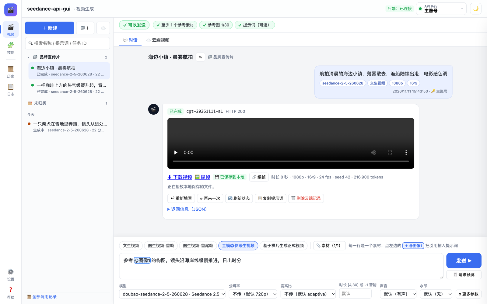
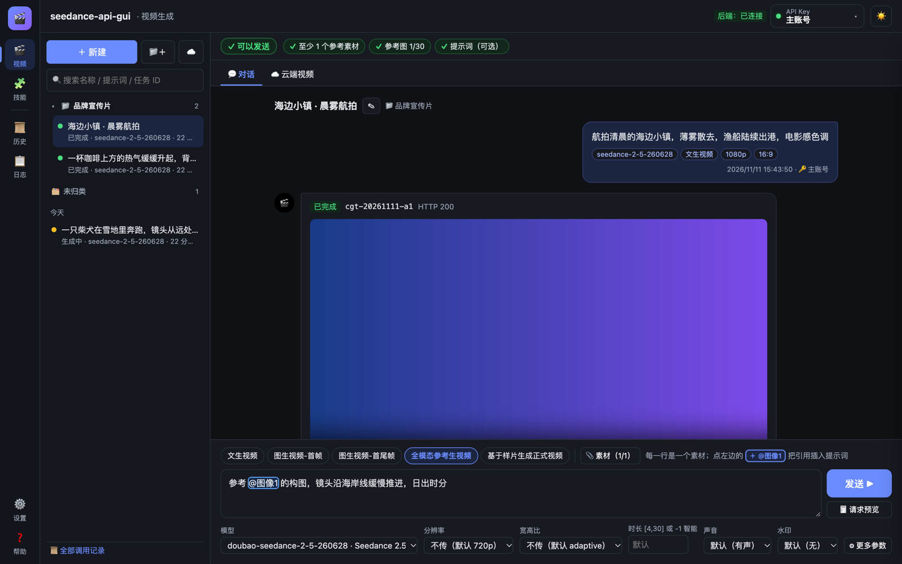
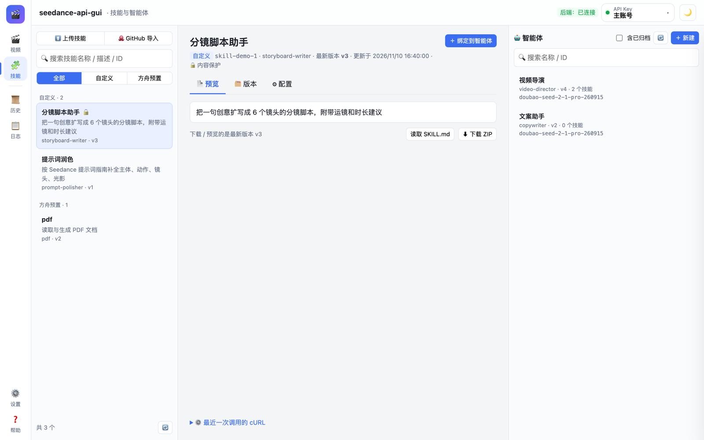
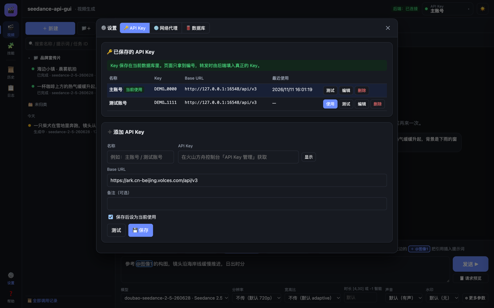
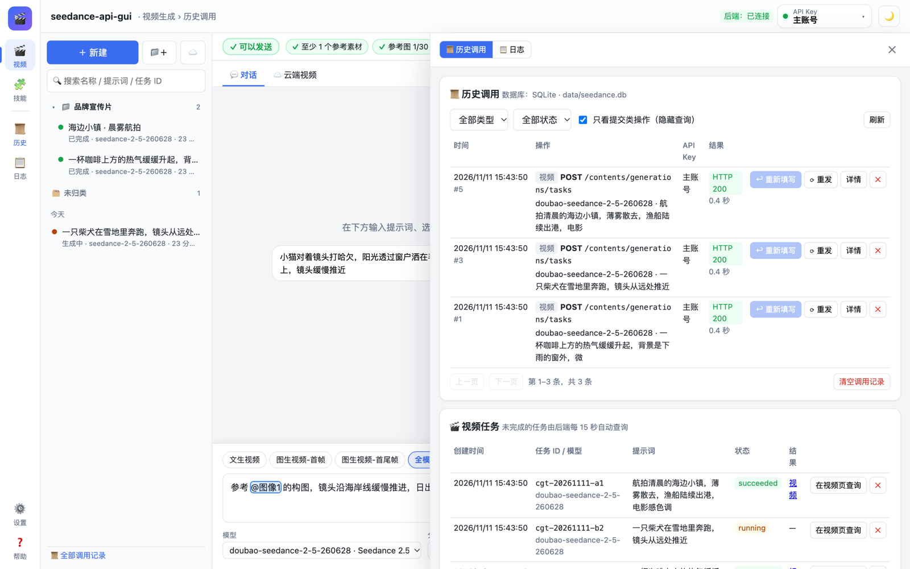
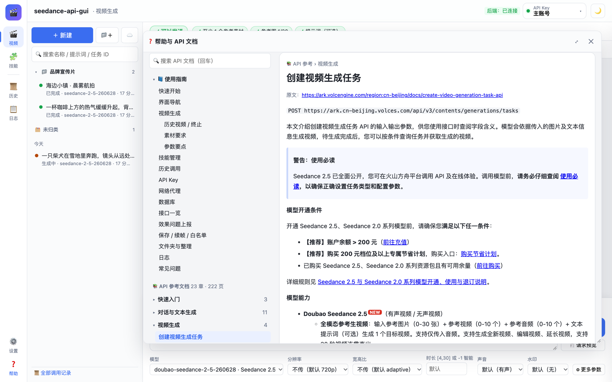

# seedance-api-gui

[](LICENSE)


**Seedance 视频生成**和 **Skills / 智能体管理**的本地图形界面：一个 Python 本地后端 + 一个单页前端，在浏览器里使用。

> 这是个人开发的非官方工具，Vibe-Coding项目，作者：Akari-Zeng，使用Claude Opus 5.5，ChatGPT Astra 6
> 与火山引擎 / 字节跳动没有关联，“Seedance”只做为本项目的索引名称，版权归属字节跳动，对应调用接口产生的费用由你的方舟账号承担。



<p align="center">
  <a href="#截图">更多截图</a> ·
  <a href="#快速开始">快速开始</a> ·
  <a href="#功能">功能</a> ·
  <a href="#安全与隐私">安全与隐私</a> ·
  <a href="#许可证">许可证</a>
</p>

## 目录

- [功能](#功能)
- [截图](#截图)
- [快速开始](#快速开始)
- [API 参考文档（可选）](#api-参考文档可选)
- [界面说明](#界面说明)
- [目录结构](#目录结构)
- [数据与日志](#数据与日志)
- [后端接口](#后端接口)
- [打包发布版](#打包发布版)
- [安全与隐私](#安全与隐私)
- [更新记录](#更新记录)
- [许可证](#许可证)

## 功能

- **🎬 视频生成（聊天式）**：文生视频、图生视频（首帧 / 首尾帧）、全模态参考生视频、基于样片生成；参数可视化选择，发送前检查必填项并用红框标出；提示词里用 `@图像1` 这样的标签引用素材。
- **☁️ 任务管理**：查询云端任务（按状态、ID、分页），终止排队中的任务，删除云端记录；可选「自动跟踪」，由后端定时查询，最长 3 小时。
- **💾 保存到本地 / 🔗 续帧**：把生成的视频和尾帧下载到本地（远程地址 24 小时后过期也能看）；用上一段的尾帧作为下一段的首帧。
- **🧩 技能与智能体**：技能上传（ZIP / SKILL.md）、GitHub 导入、版本管理、内容保护；智能体的新建、配置、技能绑定、版本历史与恢复、归档。
- **🔑 多个 API Key**：保存、命名、测试、一键切换；Key 只保存在本地后端，浏览器只拿到编号。
- **📜 历史调用**：每个请求都**先存储再发送**；可以「↩ 重新填写」恢复当时整个页面的配置，或「⟳ 重发」原报文。
- **📋 日志**：提交、返回、查询、超时、错误、任务状态等事件写入数据库，可筛选、搜索、导出；每次启动自动把上一次运行的日志导出到 `log/`。
- **📁 文件夹**：左侧历史栏可新建文件夹、拖动整理、重命名项目。
- **🌐 网络代理 / 🛢 数据库**：跟随系统 / 直连 / HTTP(S) / SOCKS5 代理；SQLite（默认）/ MySQL / PostgreSQL。
- **🌙 / ☀️ 黑暗与白天模式**，默认跟随系统。
- **❓ 内置帮助**：使用指南，以及可全文搜索的 API 参考（需要自行放入文档，见[下文](#api-参考文档可选)）。
- **不点就不请求**：页面空闲时不会主动请求方舟接口，只读取本地数据库。

## 截图

| 白天模式 | 黑暗模式 |
| --- | --- |
| [](docs/images/workspace-light.png) | [](docs/images/workspace-dark.png) |
| **视频生成**：左侧项目与文件夹，右侧对话与结果，底部提示词和参数 | 同一界面的黑暗模式 |
| [](docs/images/skills-light.png) | [](docs/images/settings-dark.png) |
| **技能与智能体**：技能列表 / 详情 / 智能体三栏 | **设置**：保存多个 API Key、网络代理、数据库 |
| [](docs/images/history-drawer-light.png) | [](docs/images/help-light.png) |
| **历史调用**：右侧抽屉，可重新填写或重发 | **帮助**：可移动的小窗口，使用指南和 API 参考 |

> 截图使用的是本地模拟接口和虚构数据，不含真实的 Key 或任务。

## 快速开始

### 环境要求

- Python **3.8+**（只用 SQLite 和 HTTP 代理时**不需要任何第三方依赖**）
- 一个现代浏览器（Chrome / Edge / Safari / Firefox）
- 火山方舟 API Key：在[火山方舟控制台](https://console.volcengine.com/ark)的「API Key 管理」中创建，并开通所需的 Seedance 模型

### macOS：一键启动

```bash
git clone <本仓库地址> seedance-api-gui
cd seedance-api-gui
bash 一键启动.command
```

也可以在 Finder 里双击 **`一键启动.command`**（第一次如果提示「来自身份不明的开发者」，请右键 → 打开）。脚本会：

1. 检查 Python 3.8+（没有就用 Homebrew 安装，或提示安装命令行工具）；
2. 创建 `.venv` 并安装 `backend/requirements.txt` 中的可选依赖（失败时自动换清华镜像）；
3. 启动服务并打开 <http://127.0.0.1:6547/>。服务已在运行时直接打开浏览器。

可选环境变量：`SAG_PORT`（端口，默认 6547）、`SAG_NO_BROWSER=1`（不打开浏览器）、`SAG_PIP_MIRROR`（pip 镜像地址）。

### 手动运行（Linux / Windows 未经测试）

```bash
python3 backend/server.py     # 默认 http://127.0.0.1:6547/
python3 backend/server.py --port 8000 --no-browser
```

需要 MySQL、PostgreSQL 或 SOCKS5 代理时，再安装可选依赖：

```bash
python3 -m pip install -r backend/requirements.txt
```

### 第一次使用

1. 打开页面后，点右上角的 **API Key** 按钮 →「添加 API Key」，填入 Key 并保存；
2. 在 🎬 视频页选择任务类型、填写提示词和素材，点「发送 ▶」；
3. 生成完成后，在结果里播放、下载，或「💾 保存到本地」。

## API 参考文档（可选）

帮助窗口里的「📚 API 参考」会读取 `docs/ark-api-reference.md`。这份文档是火山方舟官方文档的原文，**版权属于火山引擎，所以不随本仓库发布**（已写在 `.gitignore` 中）。

需要时，请从[火山方舟官方文档](https://www.volcengine.com/docs/82379)获取 API 参考，保存为 Markdown，放到 `docs/ark-api-reference.md` 后刷新页面即可；也可以在帮助窗口里直接选择本地文件。没有这份文档时，「📘 使用指南」和其他功能都不受影响。

## 界面说明

| 区域 | 打开方式 | 内容 |
| --- | --- | --- |
| 🎬 视频、🧩 技能 | 主工作区 | 最常用，占据中间的全部空间 |
| 📜 历史、📋 日志 | 右侧抽屉 | 边做边查；宽屏时与主区并排，左边缘可拖动调整宽度 |
| ⚙️ 设置 | 弹窗 | API Key / 网络代理 / 数据库；点遮罩或 Esc 关闭 |
| ❓ 帮助、🧾 请求预览 | 可移动的小窗口 | 拖动标题栏移动，右下角调整大小，双击标题栏最大化 |

- 顶栏右侧：后端状态、**API Key 按钮**（显示当前 Key，点开可切换 / 测试 / 添加 / 管理）、主题切换（⌘/Ctrl + Shift + L）。
- 视频页输入区：上面是任务类型和 📎 素材，中间是提示词和「发送」「请求预览」，下面是常用参数和「⚙ 更多参数」。
- 抽屉宽度、帮助窗口位置、上次所在的页面、主题都会被记住。

## 目录结构

```
seedance-api-gui/
├── 一键启动.command         macOS 一键安装依赖并启动
├── README.md · CHANGELOG.md · LICENSE
├── backend/
│   ├── server.py     本地后端（只监听 127.0.0.1，仅用 Python 标准库）
│   └── requirements.txt     可选依赖：PyMySQL、psycopg、PySocks
├── frontend/
│   └── index.html           单页前端
├── docs/
│   ├── images/       README 截图
│   └── ark-api-reference.md （可选，自行放入，不随仓库发布）
├── scripts/
│   └── build_release.py     打包发布版 zip
├── data/      运行时数据（首次启动时创建，已忽略，不要分享）
└── log/       每次启动时导出的上一次运行日志（已忽略）
```

## 数据与日志

运行时数据都在 `data/`：

| 文件 | 内容 |
| --- | --- |
| `data/seedance.db` | 默认的 SQLite 数据库 |
| `data/settings.json` | 数据库和代理的连接信息（权限 600） |
| `data/media/` | 「保存到本地」下载的视频和尾帧 |

数据库中的表：

| 表 | 内容 |
| --- | --- |
| `api_keys` / `app_config` | 保存的 API Key、当前使用的 Key |
| `app_state` | 页面状态，每 2 秒自动保存，刷新后恢复 |
| `snapshots` | 每次调用时的页面配置快照（相同内容只存一份） |
| `requests` | 每个请求的完整报文、所用 Key、快照编号和响应（先存储再发送） |
| `folders` / `conv_meta` | 左侧栏的文件夹，以及项目名称、所属文件夹和排序 |
| `events` | 事件日志（级别、类别、标题、详情、关联任务和请求） |
| `tasks` | 视频任务；只有开启「自动跟踪」的任务，后端才每 15 秒查询一次，最长 3 小时 |

旧版本的数据库会在启动时自动补上新增的列。

**日志导出**：每次启动时，后端把上一次运行期间新增的日志导出成 `log/yyyy-mm-dd_NN.txt`（日期取第一条日志的日期，同一天多个文件时编号递增）。只导出新日志，不重复；数据库里的日志不会被删除。

## 后端接口

| 方法 | 路径 | 说明 |
| --- | --- | --- |
| 任意 | `/proxy/<path>` | 先存储再转发到方舟。`Authorization: Bearer @key:<id>` 使用已保存的 Key；`X-SAG-Snapshot` 是快照编号，`X-SAG-Base` 是 Base URL |
| GET / POST | `/api/keys` | Key 列表（只返回打码后的 Key）/ 新增 |
| PUT / DELETE | `/api/keys/{id}` | 修改 / 删除 |
| POST | `/api/keys/{id}/activate`、`/api/keys/deactivate`、`/api/keys/test` | 切换 / 取消选择 / 测试 |
| POST / GET | `/api/snapshots`、`/api/snapshots/{id}` | 保存 / 读取配置快照 |
| GET / DELETE | `/api/requests`、`/api/requests/{id}` | 调用记录 |
| POST | `/api/requests/{id}/retry` | 用原报文和 Key 重发 |
| GET / DELETE | `/api/tasks`、`/api/tasks/{id}` | 视频任务记录 |
| GET / DELETE | `/api/conversations`、`/api/conversations/{id}` | 左侧历史栏 |
| GET / PUT / DELETE | `/api/state/ui` | 页面状态 |
| GET | `/api/settings` | 数据库、代理、驱动状态 |
| POST / PUT | `/api/settings/db/test`、`/api/settings/db` | 测试 / 切换数据库 |
| POST / PUT | `/api/settings/proxy/test`、`/api/settings/proxy` | 测试 / 保存代理 |
| GET / POST / DELETE | `/api/events` | 事件日志 |
| GET | `/docs/<name>.md` | 帮助页使用的文档 |
| GET | `/api/health` | 健康检查（含版本号） |

## 打包发布版

```bash
python3 scripts/build_release.py
```

生成 `dist/seedance-api-gui-<版本>.zip`：

- 只打包白名单中的文件（代码、页面、截图、启动脚本、说明、许可证）。`data/`、`log/`、`.venv/`、`dist/` 一律不放，只各放一个说明文件。
- 打包前逐个扫描：SQLite 数据库、私钥、Bearer 令牌、常见格式的 API Key、密码赋值、本机用户目录路径，发现任何一项就中止。

## 安全与隐私

- 后端**只监听 `127.0.0.1`**，不对局域网开放。
- API Key、数据库密码、代理密码都**以明文保存在本地**（Key 在数据库，另外两项在 `data/settings.json`）。不要分享、不要提交 `data/` 文件夹或数据库；`.gitignore` 已忽略 `data/` 和 `log/`。
- 浏览器只拿到 Key 的编号（`@key:<id>`），由后端在转发时填入真正的 Key；日志不记录 `Authorization`。
- **上游域名白名单**：后端只把 Key 转发到火山方舟 / BytePlus 的域名；第三方中转需要在「🌐 网络代理」页手动添加。
- 直接双击打开 `frontend/index.html`（不经过后端）也能用，但 Key 会存进浏览器 localStorage，且请求可能被跨域拦截，历史、代理和数据库功能不可用。
- 视频地址 24 小时内有效；**重发「创建任务」会生成新任务并产生费用**。

发现安全问题，请通过仓库的 Issue 联系（不要在 Issue 中贴出任何 Key）。

## 更新记录

见 [CHANGELOG.md](CHANGELOG.md)。

## 许可证

Copyright (C) 2026 Akari_Zeng

本程序是自由软件：你可以依据自由软件基金会发布的 **GNU 通用公共许可证第 2 版**（GPL-2.0-only）的条款重新分发和 / 或修改它。

发布本程序是希望它有用，但**不提供任何担保**，甚至不包括对适销性或特定用途适用性的默示担保。详见 [LICENSE](LICENSE) 全文，或 <https://www.gnu.org/licenses/old-licenses/gpl-2.0.html>。

火山方舟、Seedance 等名称和商标属于其各自的权利人；`docs/ark-api-reference.md`的版权属于火山引擎，不在本项目的许可范围内。
